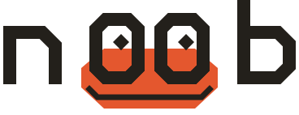

<!-- HEADER: logo swaps with the viewer's GitHub theme -->
<p align="center">
  <picture>
    <source media="(prefers-color-scheme: dark)" srcset="assets/n00b-logo-dark.svg">
    
  </picture>
</p>

<!-- TAGLINE: one sentence, under ~12 words -->
<p align="center"><strong>Always be a n00b!</strong></p>

<!-- BADGES: keep to 3–4. Status first so nobody is surprised. -->
<p align="center">
  <a href="#status"></a>
  <a href="[ci-url]"></a>
  <a href="[releases-url]"></a>
  <a href="LICENSE"></a>
</p>

<!-- NAV: the four places people go next -->
<p align="center">
  <a href="docs/why.md">Why n00b</a> ·
  <a href="docs/">Docs</a> ·
  <a href="docs/tutorial.md">Tutorial</a> ·
  <a href="docs/history.md">History</a> ·  
  <a href="CONTRIBUTING.md">Contributing</a>
</p>

---

<!-- WHAT: 2–3 sentences. What it is, who it's for, what makes it different. -->
The n00b project's goal is to make it easier for everyone with a good idea requiring software to achieve their vision, through a combination of automation, guardrails, and a focus on providing on-ramps where people can have a clear, achievable path for the building technical expertise that the world is always going to need.

At the core, is the n00b language is a modern language that is willing to rethink everything around the experience of programming. While we don't think most people will spend a lot of time looking at code, and believe they'll spend even less time writing it, code will, in some form, likely always document ground truth-- a single reference between people, agents and the underlying machine.

That needs to be simple and flexible, but a good onramp to encourage people to develop technical expertise. So in many regards, n00b is a spiritual successor to Python's original goals.

<!-- WHY: three short claims max. This is the only selling on the page. -->
We're looking to re-think everything about programming for the modern era, to make it easy for everyone to get quality results. We're willing to think outside the box. For example, some of our mantras:


- _**Simple and Easy**_: We work hard to promote simple, readable code. But, even if people write less code, it should be easier, as an onramp to learning. So, we do full-module static type inference -- because writing types is a barrier.
- _**Encourage correctness**_: Still, types are critical documentation. We re-write code to have explicit types, for education, documentation and debugging.
- _**Play well with others**_: We don't think all code should be written in n00b; we make it easy to mix and match across languages, and to use and even build DSLs that are task appropriate.

## Install

<!-- One primary command. Alternatives collapsed so the page stays short. -->
```sh
# Note: not implemented yet
curl -fsSL https://n00b-lang.org/install.sh | sh
```

<details>
<summary>Other ways to install</summary>

### Not done yet

```sh
[brew install n00b]
[pip install n00b]
```

See [below](#Contributing) for building from source.

</details>

## Hello, world

```
# hello.n
print("Hello, world!")
```

```sh
$ n00b run hello
Hello, world!
```

<!-- Optional: one slightly larger example that shows a signature feature. -->

## Learn

| | |
|---|---|
| [**Tutorial**](docs/tutorial.md) | [Coming soon.] |
| [**Language reference**](docs/guide.md) | [Syntax and semantics.] |
| [**Type system**](docs/types.md) | [Explainer.] |
| [**API reference**]([docs/stdlib.md) | [Coming soon.] |
<!-- | [**Examples**](examples/) | [Small runnable programs.] | -->

## Status

> [!NOTE]
> **n00b is pre-alpha.**
> The base language is near its final form, but, while this repo is public, I do not want it advertised outside the company until I hit the following milestones:
<!-- Roadmap: 4–6 milestones. Link the full roadmap rather than listing everything. -->
- [ ] Finish the language: effect system, wrap model and various tweaks.
- [ ] Adapt old stdlib code, and take proper ownership of it.
- [ ] Build out an initial REPL.
- [ ] Full set of human-authored documentation.
- [ ] Initial package management tooling.
- [ ] Full web site and playground.
- [ ] Compliance with my own AI policy.

After that, I have a lot of ideas on developer experience / LLM integration, and will want to explore those for quite a while. I won't want to declare *alpha* before I believe we've nailed a sustainable experience that promotes both correctness and ease of use.

# [Full roadmap →](docs/roadmap.md)

## Contributing

First, build from source.

<!-- Build from source in as few commands as possible, then point to CONTRIBUTING.md. -->
```sh
git clone https://github.com/n00b-lang/n00b.git
cd n00b
make
```

See our [contribution guidelines](docs/CONTRIBUTING.md) for guidance, code of conduct and AI policy.

## License

MIT · see [LICENSE](LICENSE).

<!-- FOOTER: pixel newt -->
<p align="center">
  <picture>
    <source media="(prefers-color-scheme: dark)" srcset="assets/n00b-newt-dark.svg">
    
  </picture>
</p>
